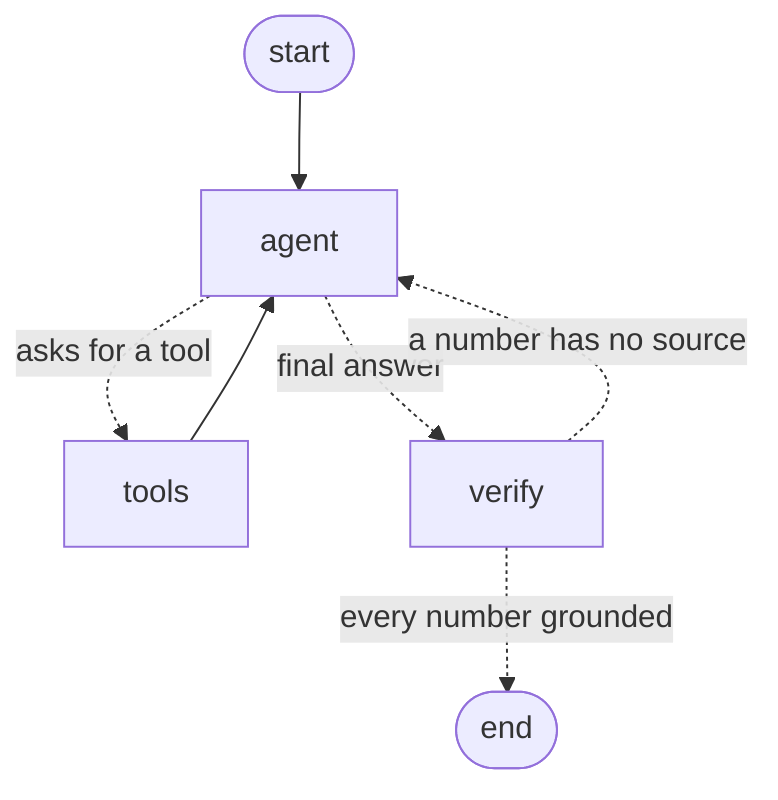
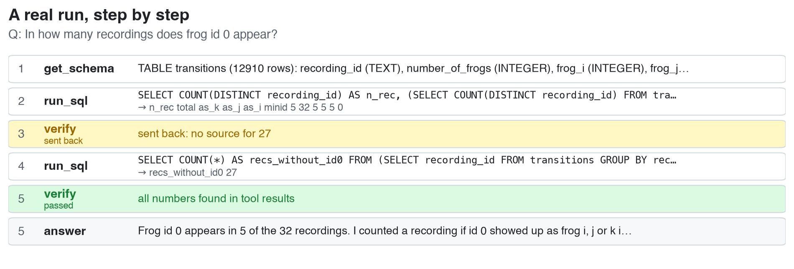
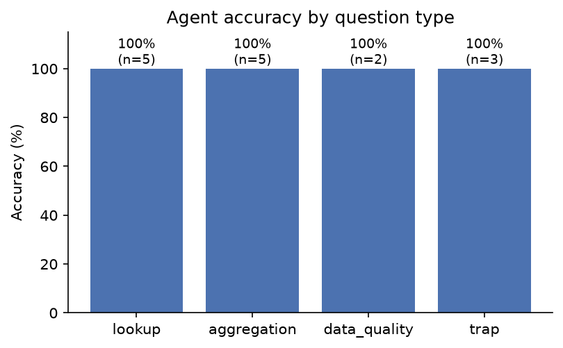

# Frog Chorus Agent

A data-analysis agent that answers natural-language questions about my thesis dataset: video recordings of tree-frog (*Hyla savignyi*) choruses, with 12,910 call transitions across 32 recordings.

The agent writes SQL and Python to answer each question. A separate **verify** step then checks that every number in the final answer appears in a tool result. If a number has no source, the answer goes back to the agent to be fixed.

Built with LangGraph and Claude. I wrote the graph myself instead of using `create_react_agent`, so every transition is explicit.

## Architecture



| Node | What it does |
|---|---|
| `agent` | Claude, with three tools bound to it |
| `tools` | Runs the requested tool. Errors come back as normal results, so the model can fix itself on the next round |
| `verify` | Extracts every number in the answer and checks it against the tool outputs, allowing for rounding and percentages. After 2 rejections it gives up and labels the answer instead of looping forever |

### Tools

| Tool | Purpose | Safeguard |
|---|---|---|
| `get_schema` | Tables, columns and row counts | Read-only connection |
| `run_sql` | One SQLite query | Read-only connection (`mode=ro`), at most 50 rows, output length capped |
| `run_python` | Statistics and plots that SQL can't do | Separate process, 30 s timeout, output length capped |

Each tool's input schema is generated from a Pydantic model and its docstring, so what the model sees always matches the code.

## Example: verify catching a computed number

On one evaluation question the model wrote *"27 recordings have no frog 0"*. It got 27 by subtracting in its head (32 − 5), not from a query. `verify` rejected the answer. The agent then ran a query, got 27 from the data, and the answer passed.



## Evaluation

There are 15 questions with known answers, in four categories:

- **lookup**: simple counts
- **aggregation**: means, medians and group-bys
- **data_quality**: questions that expose problems in the data, such as negative response delays
- **trap**: questions where a naive analysis gives a wrong answer. For example, frog IDs are assigned separately in each recording, so "frog 3" across recordings is not one animal.

Numeric questions are graded automatically, with a tolerance. Open questions are graded by an LLM judge against a written rubric.

| Metric | Result |
|---|---|
| Accuracy | 15 / 15 |
| Tool calls per question (mean) | 5.4 |
| Tool calls that worked on the first try | 98% |
| Tokens per question (mean) | ~15,700 |
| Seconds per question (mean) | ~17 |
| Verify rejections | 11, in 10 of the 15 questions |



Most verify rejections were real catches: numbers the model computed or rounded in its head, such as "about 7,800" instead of 7,858. A few were false positives, for example a threshold of 0.001 that appeared in the model's query but not in the result.

`legacy/agent.py` is my first version: a hand-written tool loop without LangGraph. Its results are in `outputs/eval_results_legacy.csv` for comparison.

## Limitations

- **`run_python` is not a sandbox.** The code runs in a separate process with a timeout, but as the local user. It can still reach the file system, the network and environment variables. In production I would run it in a container with no network access and a read-only data mount.
- **verify checks grounding, not correctness.** It confirms that every number came from a tool, not that the right query was run. The evaluation set covers correctness.
- **It skips small integers** (10 or less), because list numbering and phrases like "2 nights" are too common to check meaningfully.
- **The evaluation set is small.** 15/15 shows the agent works, but it can't separate the effect of each component. The next step is an ablation: the same questions with and without `verify`, and across models.

## Next steps

- Ablation: the evaluation with and without `verify`, and Haiku vs Sonnet for cost against accuracy
- Retrieval over the thesis text (`search_thesis`), for questions that combine the data with the methods section
- Human approval (LangGraph `interrupt`) before `run_python` executes
- A container sandbox for `run_python`

## Running it

```bash
pip install -r requirements.txt
echo "ANTHROPIC_API_KEY=your-key" > .env
python main.py "Which recording has the most transitions?"
```

Each run saves its full trace to `logs/`. To run the evaluation:

```bash
python evaluate.py
```

This writes `outputs/eval_results.csv` and `outputs/eval_accuracy.png`.

## Project structure

```
frog_agent/
  graph.py      the LangGraph graph, verify node and run loop
  config.py     model, limits and paths
  prompts.py    system prompt with domain rules
tools.py        get_schema, run_sql, run_python
main.py         ask one question from the command line
evaluate.py     run and grade the evaluation set
eval_questions.py
legacy/         first version, without LangGraph
slides/         script that builds the presentation figures from real logs
data/frogs.db   SQLite database (table: transitions)
```
